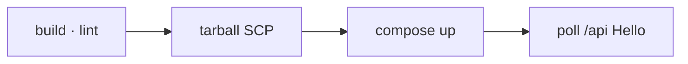
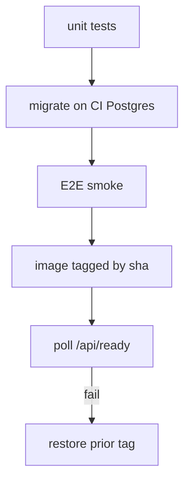
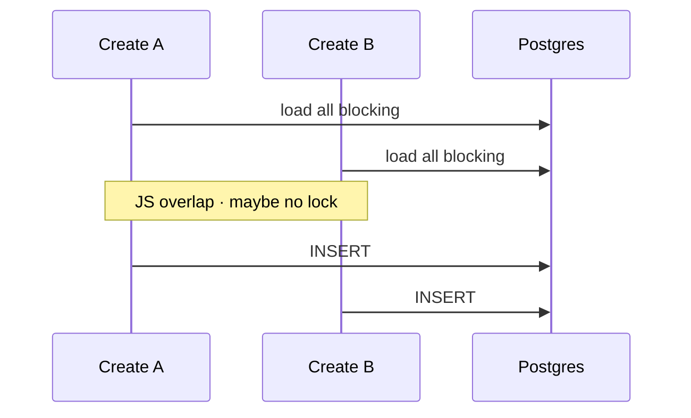
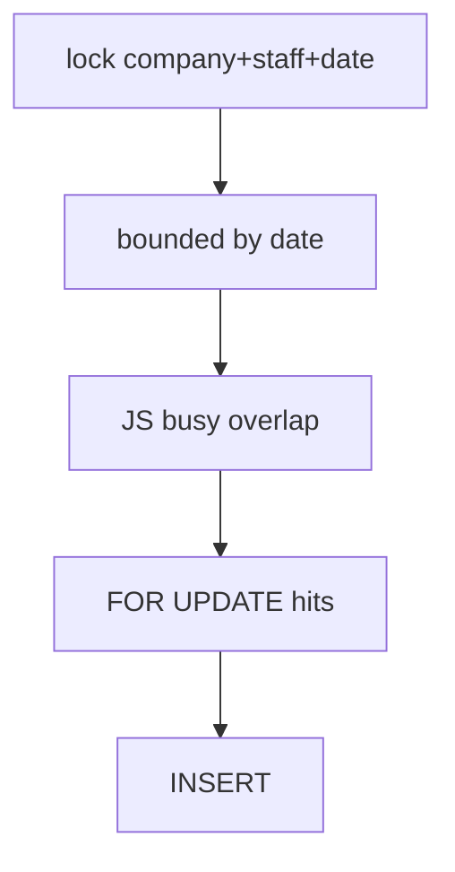
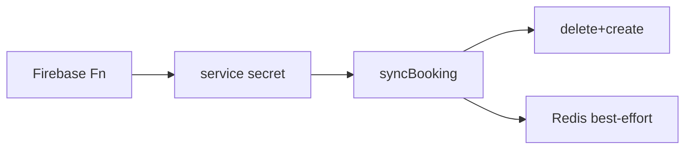
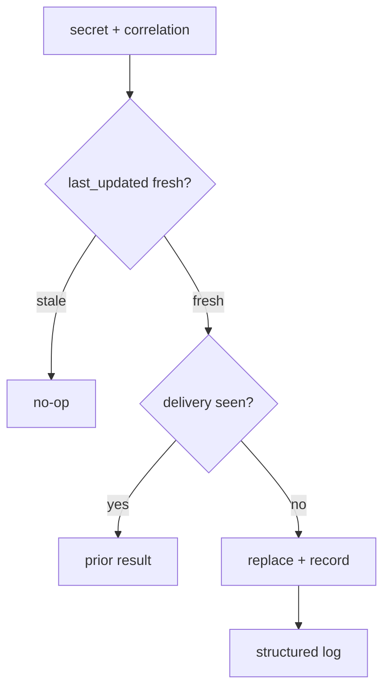

# Title

Aspio · SE1 → SE2 · Phase 1

## Nest / Backend

Three concrete proposals for the Booking Availability Backend. We own the plan; the panel assigns which one we build in Phase 2.

Proposal only · Implementation starts after written acceptance

<!-- Handouts: ../se2-assessment/challenge-*.md -->

---
title: Agenda
---

# Agenda

Part C · Nest · for eng + deployment

| # | Challenge | Risk if we do nothing |
|---|-----------|------------------------|
| **N1** | Safer releases | Broken migrate / boot can go live while Hello World still looks healthy |
| **N2** | Safer booking conflicts | Unbounded conflict checks + empty-slot races → double-book |
| **N3** | Safer booking sync | Stale or retried sync can overwrite good data; ops stay blind |

Each challenge: <strong>Problem → Evidence → Architecture → Solution → Rejected → Plan</strong> · Panel assigns <strong>one</strong> for Phase 2

---
layout: with-outline-center
title: Context
---

# Context

Nest product · Booking Availability Backend

The API that computes free slots and manages bookings. Firebase owns profiles; Postgres owns availability rules and bookings.

<ul class="big-list">
  <li><strong>Stack:</strong> NestJS 11 · Prisma 7 · PostgreSQL · Redis · Firebase Admin</li>
  <li><strong>Deploy today:</strong> GitHub Actions → Hetzner Compose (<code>main</code> / <code>staging</code> / <code>develop</code>)</li>
  <li><strong>Handouts:</strong> <code>docs/se2-assessment/</code> (full N1–N3 write-ups)</li>
</ul>

---
layout: with-outline-center
title: What Phase 1 is
---

# What Phase 1 is

<ul class="big-list">
  <li>A <strong>proposal gate</strong> — we align on problem, design, and plan before production code</li>
  <li>Panel outcomes: <strong>Accepted</strong> · <strong>Accepted with Changes</strong> · <strong>Not accepted</strong></li>
  <li>Phase 2 starts <strong>only</strong> after the written acceptance record</li>
</ul>

  <strong>Our commitment:</strong> one focused vertical slice, demoable in ~5 days, with a short runbook — no scope creep without a recorded change.  
  <strong>Ask:</strong> Assign one challenge → accept (or accept with changes) this proposal as Phase 2 scope.

---
layout: with-outline-section
title: Challenge N1
---

# Challenge N1

## Safer releases

We ship after “it builds” and a Hello World check — not after proving the database and a recoverable release tag.

Official brief: <em>Release pipeline with real database verification</em>

---
title: N1 · Problem
---

# N1 · Problem

A green build is not a safe release. Health today does not mean customers can book.

<ul class="big-list">
  <li class="danger">CI only builds and lints — unit and E2E tests never run in the pipeline</li>
  <li class="danger">Deploy polls <code>GET /api</code> Hello World — not “can we talk to Postgres?”</li>
  <li class="danger">We ship a source tarball and rebuild on the host — no clear release id to roll back to</li>
  <li>Failed poll dumps logs; the previous known-good image is not kept by tag</li>
</ul>

| Who feels it | Impact |
|--------------|--------|
| Salons / customers | A bad migrate or boot can break live booking |
| Release owners | Looks “healthy” while Postgres/Redis is wrong |
| On-call / deploy | Hard to put the last good version back |

---
title: N1 · Evidence
---

# N1 · Evidence

| Capability | Status in this repo |
|------------|---------------------|
| CI build + lint | Present — `.github/workflows/ci-cd.yml` |
| `npm test` / `test:e2e` in CI | **Missing** |
| CI Postgres service | **Missing** (`DATABASE_URL` unused) |
| Deploy artifact | Source tarball → SCP → remote `compose build` |
| Health probe | `AppController.getHello()` → `/api` |
| Ready vs alive split | **Missing** |
| API Compose healthcheck | **Missing** |
| Migrate on boot | Present — `scripts/docker-entrypoint.sh` |
| Rollback to prior tag | **Missing** |

Hard boundary we keep: no production database access from CI.

---
layout: with-outline-two-cols
title: N1 · Architecture
---

# N1 · Architecture

### Today

Trust ends at Hello World. Migrate runs on the host; ready is not proven.

### Proposed

Throwaway Postgres in CI only. Cut over only when ready. Prior tag stays recoverable.

---
title: N1 · Solution
---

# N1 · Solution

<strong>What we will own:</strong> test against a real throwaway database before go-live, only cut over when the API can serve, and put the last good release back if it cannot.

**Health checks (replaces Hello World)**

| Endpoint | Meaning | Who uses it |
|----------|---------|-------------|
| <code>GET /api/live</code> | Process is up — “the container is alive” | Orchestrator / basic uptime |
| <code>GET /api/ready</code> | Postgres answers — “safe to take traffic” | **Deploy gate** (and Compose healthcheck) |

Deploy polls <strong>ready</strong>, not live. Live can be green while the database is down — that is today’s Hello World problem.

**Also in this slice**

<ul class="big-list">
  <li>Unit tests in CI · throwaway Postgres · migrate · E2E smoke</li>
  <li>Image tagged with <code>GITHUB_SHA</code> so we know exactly what is running</li>
  <li>If ready fails → restore the previous known-good tag (demo on develop/staging)</li>
  <li>Short runbook + a deliberate fail path we can show the team</li>
</ul>

**OUT of scope**

<ul class="big-list">
  <li>Kubernetes / multi-host orchestration</li>
  <li>Mandatory registry if host-local tags are justified</li>
  <li>Production DB access from CI · full Firebase product E2E</li>
</ul>

---
title: N1 · Rejected
---

# N1 · Rejected

| Alternative | Why not for this slice |
|-------------|------------------------|
| Testcontainers for every Jest file | Extra Docker-in-Docker on <code>ubuntu-latest</code>; the brief already points at GitHub Actions Postgres services |

<strong>Chosen:</strong> GitHub Actions PostgreSQL service for CI; keep Hetzner Compose for deploy.

---
title: N1 · Plan
---

# N1 · Plan

| Day | What we deliver |
|-----|-----------------|
| 1 | `/api/live` + `/api/ready` · unit tests in the `ci` job |
| 2 | GHA Postgres + migrate + DB-backed E2E smoke |
| 3 | Docker build + sha tag · Compose healthcheck on ready |
| 4 | Deploy: record prior tag · ready poll · rollback on fail |
| 5 | Runbook · deliberate fail demo · PR polish |

  <strong>Demo promise:</strong> green CI with real throwaway Postgres · red path when ready/migrate fails · prior tag still recoverable on develop/staging. 
  <strong>Live diagnostic:</strong> Hello World 200 while ready 503 with DB down — proof the gate must change.

---
layout: with-outline-section
title: Challenge N2
---

# Challenge N2

## Safer booking conflicts

Checking one free slot still loads almost the salon’s whole booking history — and two people can still take the same empty time.

Official brief: <em>Booking conflict query and concurrency hardening</em>

---
title: N2 · Problem
---

# N2 · Problem

We promise no double-booking. Today that check grows with history, and two customers can still win the same empty slot.

<ul class="big-list">
  <li class="danger">Conflict check loads unbounded company bookings, then filters in Node</li>
  <li class="danger">Staff + time overlap is decided late in app code (JSON <code>services</code>), not a tight DB window</li>
  <li class="danger"><code>FOR UPDATE</code> is skipped when the overlap set is empty — concurrent inserts both win</li>
  <li>Useful indexes exist, but the conflict query does not bound by <code>date</code></li>
</ul>

| Who feels it | Impact |
|--------------|--------|
| Customers | Two people get the same staff time |
| Growing salons | Create latency and DB load grow with history |
| Aspio | Rare same-slot bugs that are hard to reproduce |

---
title: N2 · Evidence
---

# N2 · Evidence

| Finding | Path |
|---------|------|
| Unbounded conflict `findMany` | `src/bookings/bookings.service.ts` (`findStaffConflict`) |
| Lock only on pre-found IDs | `lockStaffOverlaps` + raw `FOR UPDATE` |
| Busy / overlap in JS | `src/bookings/booking-json.helpers.ts` |
| Indexes: `(companyId, date)`, `status`, `isTrashed` | `prisma/schema.prisma` `Booking` |
| Customer path locks; business create may skip | `createBooking` + `isBusinessBookingSource` |
| No real-DB concurrency tests | helper specs only |

We keep Firebase-compatible JSON <code>services[]</code> — a wholesale data rewrite is out of the default slice.

---
layout: with-outline-two-cols
title: N2 · Architecture
---

# N2 · Architecture

### Today

Empty slot: both requests can insert.

### Proposed

Same JSON shape. Bound the read. Serialize empty-slot creates for that staff-day.

---
title: N2 · Solution
---

# N2 · Solution

<strong>What we will own:</strong> only load bookings near the requested day, lock that staff’s day while booking, and prove two people cannot take the same empty slot.

**IN scope (smallest vertical slice)**

<ul class="big-list">
  <li>Bound conflict reads by company + date window + blocking status</li>
  <li><code>pg_advisory_xact_lock</code> (or panel-approved equivalent) before read/insert</li>
  <li>Index migration if accepted — reviewable Prisma SQL</li>
  <li>Real Postgres tests: conflict · none · multi-service · concurrent → one 409</li>
  <li>Before/after query evidence + migrate/rollback runbook</li>
</ul>

**OUT of scope**

<ul class="big-list">
  <li>Wholesale occupancy table / removing JSON <code>services</code></li>
  <li>Changing business “allow overlap” product rules</li>
  <li>Rewriting availability’s separate company-wide load (residual — noted, not this slice)</li>
</ul>

  Panel may adjust assumptions → recorded as <strong>Accepted with Changes</strong>. We will not expand scope silently.

---
title: N2 · Rejected
---

# N2 · Rejected

| Alternative | Why not for this slice |
|-------------|------------------------|
| Derived occupancy / intervals table | High sync + backfill cost; dual source of truth with the Firebase mirror |

<strong>Chosen:</strong> date-bounded JSON query + advisory lock for the 3–5 day slice; occupancy table stays a future scale option.

---
title: N2 · Plan
---

# N2 · Plan

| Day | What we deliver |
|-----|-----------------|
| 1 | Baseline EXPLAIN + row counts on seeded company |
| 2 | Date-bounded conflict query + spill-aware window |
| 3 | Advisory lock + concurrent regression (one 201, one 409) |
| 4 | Index migration (if accepted) + after EXPLAIN |
| 5 | Runbook · residual notes · PR |

  <strong>Demo promise:</strong> two parallel customer creates for one slot → one 201, one 409 · query row count stays O(window). 
  <strong>Live diagnostic:</strong> before/after EXPLAIN on representative seed — not production data.

---
layout: with-outline-section
title: Challenge N3
---

# Challenge N3

## Safer booking sync

When Firebase syncs bookings into Nest, retries and older messages can overwrite newer data — and we barely see what happened.

Official brief: <em>Observable and idempotent booking synchronization</em>

---
title: N3 · Problem
---

# N3 · Problem

Sync keeps Postgres in line with Firebase. Silent corruption and silent “success” are both unacceptable.

<ul class="big-list">
  <li class="danger">Replace = delete + create; <code>last_updated</code> is stored but never compared</li>
  <li class="danger">No delivery / idempotency identity for HTTP retries</li>
  <li class="danger">Plain Nest logs — no correlation, structured outcomes, or sync metrics</li>
  <li>Redis cache invalidate is best-effort (<code>warn</code> only)</li>
</ul>

| Who feels it | Impact |
|--------------|--------|
| Customers / staff | Wrong free/busy times after a bad sync |
| Operators / deploy | Hard to answer “did sync apply?” |
| Aspio | Retry storms without an audit trail |

---
title: N3 · Evidence
---

# N3 · Evidence

| Finding | Path |
|---------|------|
| Route `POST .../firestore-sync` | `src/internal/internal.controller.ts` |
| Auth `x-service-secret` | `src/auth/service-secret.guard.ts` |
| Replace write | `InternalService.syncBooking` |
| `last_updated` write-only | create payload in `syncBooking` |
| Cache invalidate best-effort | `availability.service.ts` |
| Deploy health = Hello World | `src/app.controller.ts` |
| Caller retries (reference) | `reference/firebase-functions/nestBackend.ts` |

Auth boundary stays: one shared secret = full internal write power. No secrets in slides or demos.

---
layout: with-outline-two-cols
title: N3 · Architecture
---

# N3 · Architecture

### Today

Last writer wins — including stale retries.

### Proposed

Entity + version + delivery id. PII redacted in logs.

---
title: N3 · Solution
---

# N3 · Solution

<strong>What we will own:</strong> ignore older sync messages, remember retries, and log clear outcomes without customer private data.

<ul class="big-list">
  <li><strong>On the booking:</strong> compare incoming <code>last_updated</code> to what we already stored — older → no-op (do not overwrite)</li>
  <li><strong>Per delivery (not on the booking row):</strong> caller sends an idempotency / delivery key in a header; we store it in a small ledger so the same retry returns the prior result</li>
  <li>Clear logs with a correlation id: synced · skipped · stale · duplicate · error (no PII)</li>
  <li>One simple ops/health signal so we can see sync health</li>
  <li>Real-DB tests for duplicate and “old message” cases + a short runbook</li>
</ul>

Booking identity stays <code>group_id</code>. Version lives on the booking; idempotency lives on the <em>delivery</em>.

---
title: N3 · Rejected
---

# N3 · Rejected

| Alternative | Why not for this slice |
|-------------|------------------------|
| Natural-key replace only (“retries are fine”) | Identical retries may be OK; <strong>out-of-order stale docs still corrupt</strong> |

<strong>Chosen:</strong> version guard on <code>last_updated</code> + delivery idempotency ledger — not natural-key alone.

---
title: N3 · Plan
---

# N3 · Plan

| Day | What we deliver |
|-----|-----------------|
| 1 | Correlation + structured redacted sync logs |
| 2 | `last_updated` guard + E2E stale/success |
| 3 | Delivery idempotency persistence + duplicate E2E |
| 4 | Operational signal + ready touches DB |
| 5 | Runbook · replay rules · PR demo script |

---
layout: with-outline-center
title: Closing
---

# Closing

We are ready to execute whichever challenge the panel assigns — same rhythm, same discipline.

<ul class="big-list">
  <li><strong>N1</strong> — safer releases for eng + deploy</li>
  <li><strong>N2</strong> — correct booking under concurrency</li>
  <li><strong>N3</strong> — trustworthy, visible sync</li>
</ul>

  <strong>How we work Phase 2:</strong> smallest vertical slice · CI green · short runbook · no secrets or customer data in git · demo on develop/staging first.  
  <strong>Ask:</strong> Assign one challenge and accept (or accept with changes) so we can start.

